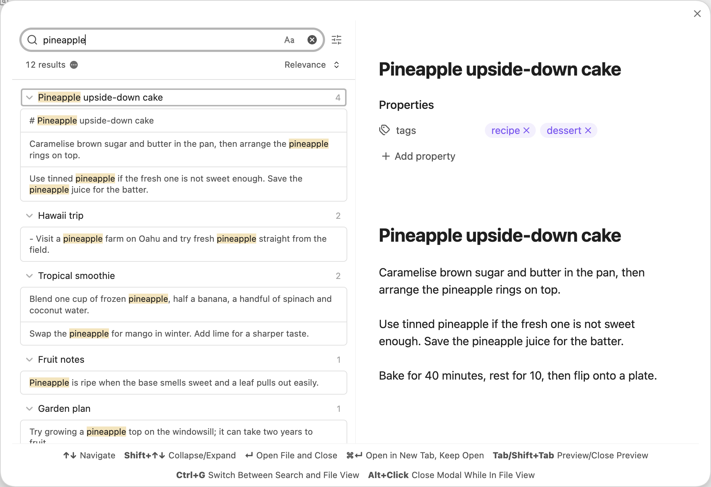

# Search & Open

> **Work in progress.** The scope and the name may still change. It is not available in the Obsidian Community plugin store yet.

Search your vault with Obsidian's own search in a floating modal, then open the match you want. A preview pane lets you check a result before opening it.

> **Looking for a full-featured floating search?** Use [Floating Search](https://github.com/Quorafind/Obsidian-Float-Search) by Boninall (Quorafind), the plugin this one is derived from. It has a quick switcher, saved searches, filters and more views. Search & Open deliberately does much less.

## About this plugin

Search & Open started as a fork of [Floating Search](https://github.com/Quorafind/Obsidian-Float-Search) by Boninall (Quorafind) and is now best described as a derivative. It is a much smaller plugin with a narrower purpose, and it is not a drop-in replacement for Floating Search, nor meant to compete with it. About a third of the current source lines (31% by a rough count against Floating Search 4.3.0 and 4.4.1) are still verbatim from it, and the rest was removed, rewritten or added here. Seen from the other side, this plugin is 40% the size of Floating Search 4.3.0 (1,107 against 2,777 lines of code), and about 11% of Floating Search's lines are still here, mostly as scattered lines rather than whole blocks. [docs/history.md](docs/history.md#how-much-of-floating-search-is-used) has the details.

What carries over is the idea and the architecture: the floating modal wrapping Obsidian's own search view, the embedded preview, most of the keyboard handling and the `obsidian://fs` link. Credit for those goes to the original author. The CI pipeline, the end-to-end tests and the match highlighting in the preview are new here, and so are the settings and the plugin's lifecycle handling.

It also keeps pieces of two other forks of Floating Search: [Float Search Window](https://github.com/AiurArtanis/Obsidian-Float-Search-Window) by AiurArtanis and [Obsidian Float Search](https://github.com/Peingxious/Obsidian-Float-Search) by Peingxious. See [Credits and licensing](#credits-and-licensing) for what came from where, and [docs/history.md](docs/history.md) for how the shares were measured and their limits.

### What is different

This version does one thing: open a floating search and open the file that matches. It keeps to Obsidian's own search and avoids re-implementing what Obsidian already does. The query syntax, results, ranking and highlighting all come from Obsidian.

Floating Search and its forks added their own quick switcher with a hand-written query engine, saved searches, hidden folders, a filter bar with a regex mode, quick note creation, split, tab, window and sidebar views, and more commands. Those are not included here, and there are no plans to add them. If you need them, use Floating Search, which is actively maintained, or one of the forks.

## Installation

Until the plugin is available in the Community plugin store, install it with [BRAT](https://github.com/TfTHacker/obsidian42-brat):

1. Install and enable **BRAT** from **Settings → Community plugins**.
2. Open the command palette and run **BRAT: Add a beta plugin for testing**.
3. Enter `hugoh/obsidian-search-open` and confirm.
4. Enable **Search & Open** under **Settings → Community plugins**.

BRAT also keeps the plugin up to date.

> **Do not install Floating Search, or any of its forks, at the same time.** Both plugins change the same parts of Obsidian and answer `obsidian://fs` links, so running them together breaks both. Disable or uninstall the other one first.



## Usage

1. **Two commands**:
    - `Search Obsidian globally`: opens an empty search;
    - `Search Obsidian globally (with last state)`: reopens with the last query and the cursor where you left it, for 30 seconds after each search.
2. **When the cursor is in the search box**:
    - Use the up and down arrow keys (or Ctrl+N and Ctrl+P) to move between results; after a short pause (150 ms) the selected result is previewed on the right;
    - With a result selected, hold Shift and press up or down to expand the results above or below it; on a file name, collapse the results under it;
    - With a result selected:
        - Press Enter to open the file and close the popup;
        - Press Ctrl+Enter (Cmd+Enter on macOS) to open the file in a new tab and keep the popup open;
        - Press Ctrl+Shift+Alt+Enter to open the file in a new window and close the popup;
    - Press Tab to preview the selected result straight away, and Shift+Tab to close the preview;
    - While a file is previewed, press Ctrl+G to jump from the search box into the preview, or from the preview back to the search box;
    - On a match line, press Tab again to jump into its preview, and Ctrl+Tab to come back to the search box.
3. **Mouse**:
    - While a file is previewed, clicking another result switches the preview instead of closing the popup; Alt+click opens the file and closes the popup;
    - With no preview, clicking a result closes the popup and navigates to the file, as in Obsidian's own search.
4. **`obsidian://fs?query=xxxxxx`** opens the popup with that query, so you can start a search from outside Obsidian.

## Settings

- **Show instructions** shows the key hints under the modal.
- Obsidian's own sort order (relevance by default), collapse, extra context, explain and match-case toggles are remembered between sessions. The query itself is never saved.

## Recent files

Previewing is not opening. A file you only preview in the modal is not added to Obsidian's recent files (which the quick switcher uses), nor to the list of the [Recent Files](https://github.com/tgrosinger/recent-files-obsidian) plugin if you use it. A file you open with Enter, or Cmd/Ctrl+Enter, is recorded as usual.

Requires Obsidian 1.15.1 or later.

## Development

```sh
bun install
bun run build        # type-check and bundle to main.js
bun run lint         # eslint-plugin-obsidianmd
bun run test         # unit tests (bun) + regression tests (node)
bun run test:e2e     # runs the plugin in a real Obsidian (wdio-obsidian-service)
bun run test:e2e:container  # same, in a Linux container, with no window on your machine
```

## Credits and licensing

Search & Open is a derivative work and is licensed under the **GNU General Public License v3.0** (see [LICENSE](LICENSE)). Floating Search and the forks it draws on are all GPL-3.0, so their code can be combined here. [docs/history.md](docs/history.md) records where each feature came from and every fix made while merging, including features that were later removed.

| Source | What this plugin took from it | License |
|---|---|---|
| [Quorafind/Obsidian-Float-Search](https://github.com/Quorafind/Obsidian-Float-Search) (Boninall) and its contributors | The original plugin: the floating modal, the embedded search view and preview, the keyboard navigation and the `obsidian://fs` handler | GPL-3.0 |
| [AiurArtanis/Obsidian-Float-Search-Window](https://github.com/AiurArtanis/Obsidian-Float-Search-Window) | The composition (IME) guard, the typed localization and its Chinese translation, preview and file-opening lifecycle fixes, and the regression test harness | GPL-3.0 |
| [Peingxious/Obsidian-Float-Search](https://github.com/Peingxious/Obsidian-Float-Search) | Applying the patches on first use (its crash guard for highlights in embedded previews was removed with the editable preview) | GPL-3.0 |
| [nothingislost/obsidian-hover-editor](https://github.com/nothingislost/obsidian-hover-editor) | The embedded leaf implementation (`src/leafView.ts`) and the `getRoot` patch in `src/main.ts`, both reached through Floating Search | MIT |
| [pjeby/monkey-around](https://github.com/pjeby/monkey-around) | Method patching (bundled dependency) | ISC |
| [Phosphor Icons](https://phosphoricons.com) | The ribbon icon | MIT |

[smilingpoplar/Obsidian-Float-Search](https://github.com/smilingpoplar/Obsidian-Float-Search) (GPL-3.0) was reviewed; no code was taken from it. See [NOTICE](NOTICE) for the full third-party notices.
